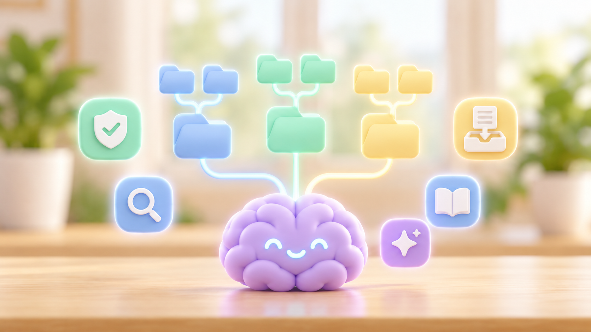

# Ottho Brain



Plugin **Claude Code** et **Codex** de l'Ottho Academy qui installe un second
cerveau complet sur le modèle de BrainOS : un dossier Markdown versionné qui
devient la source de vérité de tes agents.

- **Hub de navigation** `index.md` et un `--index-<dossier>.md` généré dans
  chaque dossier : les agents descendent de proche en proche, sans jamais
  charger tout le cerveau.
- **Trois routes à responsabilité exclusive** (moi, mon activité, ce que
  j'apprends), dont tu choisis les noms et les sous-dossiers, plus `ia/` (le
  plan de contrôle des agents) et **le Sas** (zone d'arrivée).
- **Règles** toujours actives : source de vérité, classification C0–C4,
  sécurité, style de réponse, documentation.
- **Ingestion sécurisée** par un skill dont tu choisis le nom (`bouffe-tout`
  par défaut) : scan déterministe, tri C0–C4, lecture réelle, vérification
  des faits, écriture canonique, journal signé, commit local.
- **Journal append-only** signé par HMAC, **Git local** avec hook qui bloque
  secrets, données privées, navigation cassée et réécriture du journal.
- **Moteur sans dépendance** (`node scripts/brain.mjs`, ou `bun`) : recherche
  bornée, index, contrôles, scan, staging exact, corbeille, sync.
- **Branchement automatique** : bloc géré en tête de `~/.claude/CLAUDE.md` et
  de `~/.codex/AGENTS.md`, skills liés dans `~/.claude/skills` et
  `~/.agents/skills`, règles copiées pour Claude. Ton contenu existant est
  conservé et sauvegardé.
- **Rapatriement** de tes skills, agents, commandes et règles existants dans
  `ia/`, avec sauvegarde des originaux.

## Installer le plugin

### Claude Code

```bash
claude plugin marketplace add Atlancius/ottho-brain
```

```bash
claude plugin install ottho-brain@ottho-brain
```

Puis, dans Claude Code : « installe mon second cerveau » (ou
`/ottho-brain:installer-cerveau`).

### Codex

```bash
codex plugin marketplace add Atlancius/ottho-brain
```

```bash
codex plugin add ottho-brain@ottho-brain
```

Puis, dans Codex : « installe mon second cerveau » (ou `$installer-cerveau`).

`Atlancius/ottho-brain` est le dépôt GitHub du plugin ; un chemin local marche
aussi (`codex plugin marketplace add ./ottho-brain`).

## Ce que fait l'installation

Un questionnaire en six phases (profil, emplacement, structure des dossiers,
ingestion, sécurité et Git, IA), un récapitulatif avec aperçu de l'arbre, puis
l'installation. Rien n'est écrit avant ton oui ; rien n'est modifié dans
`~/.claude` ou `~/.codex` avant un second oui.

| Pack | Skills installés dans le cerveau |
|---|---|
| Cœur (toujours) | skill d'ingestion (nom au choix), `note-ca`, `cherche-cerveau`, `maj-index`, `ajoute-log`, `audit-cerveau`, `nouveau-dossier` |
| Rituels | `journal-du-jour`, `revue-hebdo`, `capture`, `bilan-mensuel` |
| Méta IA | `cree-skill`, `rapatrie-ia`, `sync-ia`, `usage-ia` |
| Projets | `doc-projet`, `fiche-projet`, `portefeuille` |

Les skills vivent **dans le cerveau** (`ia/skills/`) : le cerveau reste
autonome même si le plugin est désinstallé. Le plugin garde deux skills :
`installer-cerveau` et `reparer-cerveau` (diagnostic, mise à jour, rebranchement,
cerveau déplacé, désinstallation propre).

## Prérequis

- Node.js 18 ou plus (ou Bun) ;
- Git (recommandé) ;
- Claude Code et/ou Codex.

Windows, macOS et Linux. Sous Windows, les skills sont liés par des jonctions
(aucun droit administrateur requis).

## Développer

```bash
node tests/smoke.mjs
```

Recette de bout en bout dans un dossier temporaire avec un faux dossier
personnel : installation, branchement, rapatriement, mutation, sécurité,
recherche, mise à jour, désinstallation. Documentation du projet : [`docs/`](docs/README.md).

## Licence

MIT — voir [LICENSE](LICENSE).
